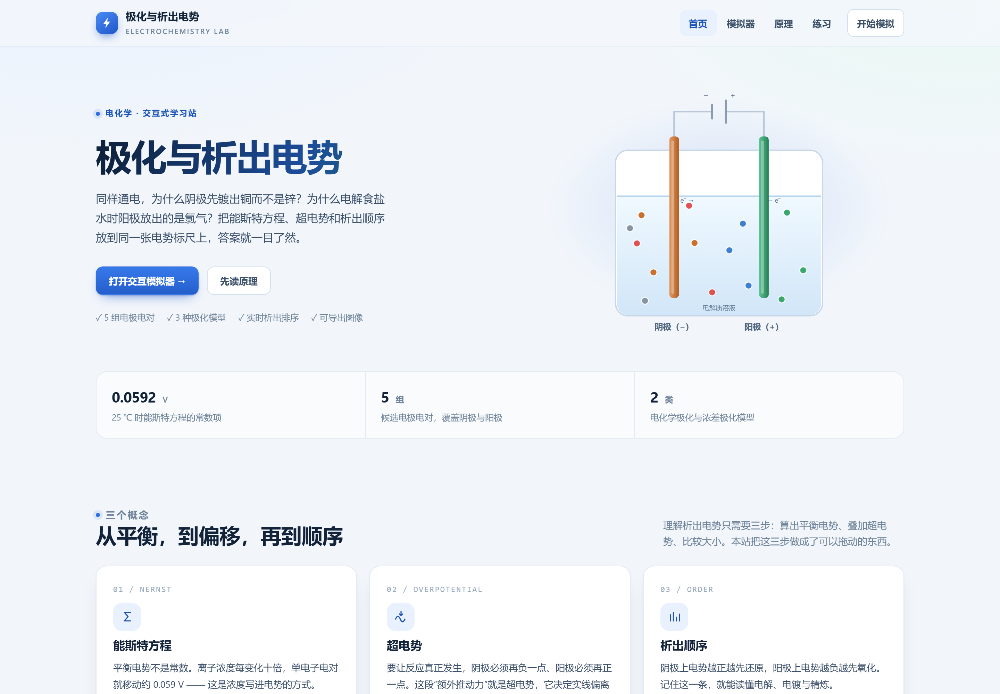
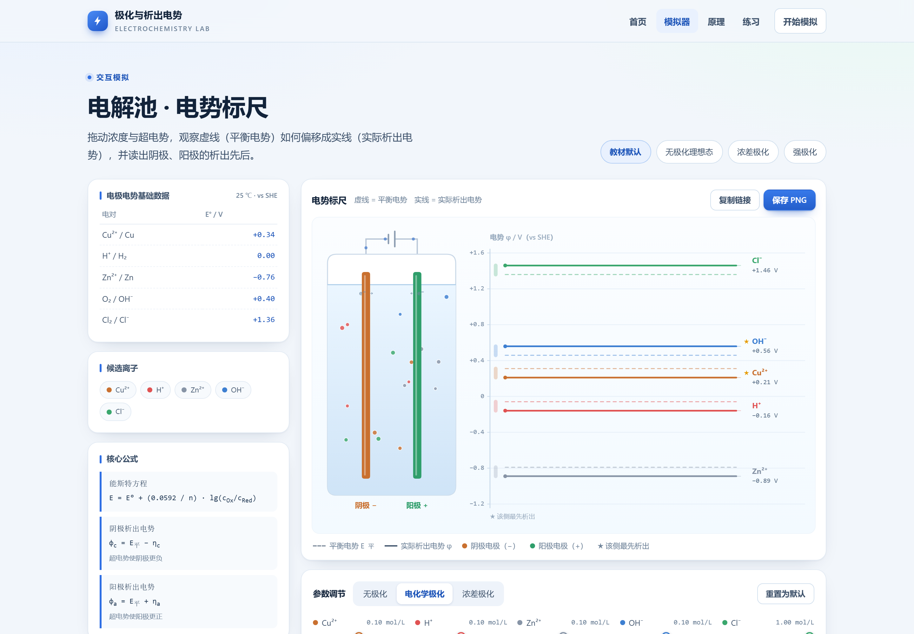

# 极化与析出电势 · 交互式教学网站

由单页 HTML《极化与析出电势》扩展而成的多页静态网站：讲清 **能斯特方程 → 超电势 → 析出顺序** 这条主线，并把计算过程做成可以拖动、可以验证的交互。





## 快速开始

直接用浏览器打开 `index.html` 即可，无需服务器、无需构建、无需联网（全部使用系统字体与原生 API）。

```text
polarization-site/
├─ index.html          首页：概念导览、电势预览、学习路径
├─ simulator.html      电解池模拟器：Canvas 电势标尺 + 参数调节
├─ theory.html         原理与公式：能斯特、两类极化、析出判据、实例、误区
├─ practice.html       练习：排序闯关、7 题自测、随机计算
├─ preview.png         首页截图
├─ preview-simulator.png 模拟器截图
├─ assets/
│  ├─ css/main.css     设计系统与全部页面样式
│  └─ js/
│     ├─ model.js      电极数据与计算模型（页面共用）
│     ├─ sim.js        模拟器：Canvas 绘制与交互
│     ├─ practice.js   排序游戏、选择题、计算题
│     └─ site.js       原理页目录滚动高亮
└─ README.md
```

> 如果希望通过 `http://` 访问（例如投屏、局域网分享），在该目录执行 `python -m http.server 8000`，再访问 `http://localhost:8000`。注意 `file://` 也能完整运行。

## 页面功能

### 模拟器（simulator.html）
- **Canvas 电势标尺**：左侧电解池示意（离子漂浮、电子流动），右侧以真实比例绘制各电对的平衡电势（虚线）与实际析出电势（实线），并用彩色竖条标出超电势造成的偏移。
- **三种极化模式**：无极化 / 电化学极化 / 浓差极化，切换后实线与虚线的关系立即改变。
- **浓度与超电势滑块**：浓度为 0.01–1.0 mol/L 的对数刻度；超电势 0–0.60 V。
- **情景预设**：教材默认、无极化理想态、浓差极化、强极化。
- **实时结论**：阴极/阳极最先析出的物质、理论分解电压、逐项排序与数值对照。
- **导出与分享**：一键保存 PNG（附条件水印），或复制带参数的链接，复现同一组条件。

### 原理页（theory.html）
能斯特方程的两种写法与使用细节、电化学极化（Tafel）与浓差极化（极限电流）、影响超电势的因素、析出判据与两道例题、电解食盐水 / 电解水 / 电解精炼铜三个实例、五条常见误区、术语速查。

### 练习页（practice.html）
- 排序闯关：可切换四种条件，逐个上下移动，提交后逐项判定对错，也可直接看答案与数值。
- 概念自测：7 道单选题，提交后标出正确项并给出解析，统计得分。
- 计算练习：每次随机生成浓度与超电势，检查两问四空（允许 ±0.008 V），并可展开解题步骤。

## 计算约定

| 项目 | 约定 |
| --- | --- |
| 温度 | 25 ℃（298 K） |
| 能斯特系数 | 0.0592 V，`E = E° + (0.0592/n)·lg(c_Ox/c_Red)` |
| 阴极 | `φ_c = E_平 − η_c`（更负） |
| 阳极 | `φ_a = E_平 + η_a`（更正） |
| 析出顺序 | 阴极：φ 越正越先；阳极：φ 越负越先 |
| 分解电压 | `U = φ_a(最先) − φ_c(最先)`，不含欧姆压降 |

电极数据（25 ℃，vs SHE）：Cu²⁺/Cu +0.34、H⁺/H₂ 0.00、Zn²⁺/Zn −0.76、O₂/OH⁻ +0.40、Cl₂/Cl⁻ +1.36。

## 模型边界（重要）

这是教学简化模型，用于建立方向感与数量级直觉，不应直接用于工程计算：

1. 以浓度代替活度，忽略活度系数；
2. 仅包含电化学极化与浓差极化，**不含**溶液欧姆压降、盐桥与液接电势；
3. 电化学极化按“电极侧”统一取值，而真实超电势是**每个反应**的属性，与电极材料、电流密度、表面状态、温度强相关；
4. 浓差极化使用 `η = (0.0592/n)·(−lg c)` 的简化式，而非完整的扩散层模型；
5. O₂/OH⁻ 为碱性电对（E° = +0.40 V）。氯碱工业中析氧与析氯的相对顺序受 pH 强烈影响，原理页已单独说明。

## 修改指南

- **改电极数据**：编辑 `assets/js/model.js` 中的 `IONS`（`E0`、`n`、`sign`、`side`、`color`）以及 `simulator.html` 左侧的数据表。
- **改默认值 / 预设**：`model.js` 的 `DEFAULTS` 与 `PRESETS`。
- **改配色**：`assets/css/main.css` 顶部 `:root` 变量；Canvas 中的颜色在 `sim.js` 的 `COL` 常量，两者需同步调整。
- **增减题目**：复制 `practice.html` 中的 `.quiz-q` 块，设置 `data-answer` 与 `data-ok`/`data-no` 文案；题目总数会自动统计。

## 兼容性

需要支持 Canvas 2D、CSS 自定义属性、`ResizeObserver` 与 `URLSearchParams` 的现代浏览器（Chrome / Edge / Firefox / Safari 近三年版本）。同时适配桌面与手机，并在 `prefers-reduced-motion` 下关闭动画。
